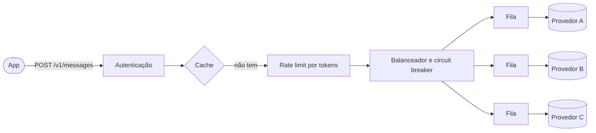

# llm-gateway

[](https://github.com/nicomsz/llm-gateway/actions/workflows/ci.yml)
[](LICENSE)

POC de um **gateway de LLM**: um servidor que fica entre os apps e as APIs de modelos.
Os apps chamam o gateway no lugar do provedor, e o gateway resolve em um lugar só o que
todo app com LLM em produção acaba precisando: esconder a chave real, impedir que um
cliente gaste a cota de todos, trocar de provedor quando um cai, repassar a resposta em
streaming e registrar quanto cada request custou.

Projeto de estudo de system design. Não é para produção (veja [Limites](#limites)).

> **English:** a proof-of-concept LLM gateway in Node.js and TypeScript, with no web
> framework: per-tenant rate limiting counted in model tokens, SSE streaming pass-through
> with cancellation and backpressure, load balancing with failover, circuit breaker,
> bounded queues, response cache and a JSONL request log with cost per request. It ships
> with mock providers and load experiments that measure each mechanism on and off. The
> documentation is in Portuguese.

## O caminho de um request



Um request pode sair do caminho antes do fim: o cache responde na hora quando já tem a
resposta guardada, e o rate limit devolve `429` quando o tenant está sem saldo.

| Parada | O que faz | Onde está |
| --- | --- | --- |
| Autenticação | Troca a chave do tenant pela chave real do provedor. O app nunca vê a chave real. | `server.ts` |
| Cache | Responde requests idênticos sem chamar o provedor. Só quando o cliente pede, pelo header `x-gateway-cache`. | `cache.ts` |
| Rate limit | Token bucket por tenant, contado em tokens do modelo e não em requests. | `tokenBucket.ts`, `redis.ts` |
| Balanceador | Escolhe o provedor (rodízio ou o menos ocupado) e tenta outro quando o escolhido falha. | `balancer.ts` |
| Circuit breaker | Para de enviar requests a um provedor que está falhando e testa de tempos em tempos se ele voltou. | `breaker.ts` |
| Fila | Limita quantos requests ficam em andamento por provedor. O excedente espera numa fila com tamanho máximo; fila cheia devolve `503`. | `limiter.ts` |
| Streaming | Repassa os eventos SSE conforme chegam e cancela a chamada no provedor quando o cliente fecha a conexão. | `server.ts`, `sse.ts` |
| Log | Uma linha JSON por request: tenant, provedor, latência, tokens, custo e cada tentativa. | `log.ts`, `report.ts` |

O gateway fala o formato da API de mensagens da Anthropic (`POST /v1/messages`), com e
sem streaming. A ideia é que o app só troque a URL base e a chave.

## O que os experimentos mostraram

`pnpm bench` sobe os provedores falsos e o gateway como processos separados e mede cada
mecanismo ligado e desligado. As tabelas completas estão em
[docs/resultados.md](docs/resultados.md).

**1. Mandar o request para o provedor menos ocupado piora uma queda.**
Com 1 de 3 provedores devolvendo erro, o rodízio (round-robin) perdeu 33,3% dos requests.
A estratégia "menos ocupado" (least-in-flight) perdeu 87,2%. O provedor caído responde o
erro quase na hora, então ele quase nunca tem request em andamento, e o balanceador
conclui que ele é o mais livre.

**2. Failover zera os erros, mas dobra a latência.**
Tentando outro provedor depois da falha, os erros foram de 87,2% para 0%. Só que quase
todo request ainda tentou primeiro o provedor caído (1.196 de 1.200) e esperou o
intervalo entre tentativas: a mediana (p50) subiu de 104 ms para 206 ms.

**3. O circuit breaker devolve a latência.**
Depois de 5 falhas seguidas o gateway para de enviar requests ao provedor caído. As
chamadas a ele caíram de 1.196 para 8, e o p50 voltou para 104 ms, com 0% de erro.

**4. Provedor travado é pior que provedor caído.**
Com 1 de 3 provedores aceitando a conexão e não respondendo, cada request que caiu nele
esperou o tempo limite de 1 s. Sem circuit breaker: p99 de 1.270 ms e 138 requests acima
de 1 s. Com circuit breaker: p99 de 118 ms e 16 requests acima de 1 s.

**5. Sem rate limit, um tenant derruba o outro.**
O tenant `acme` enviou 3 vezes a capacidade do provedor. O tenant `beta`, que enviava
pouco, perdeu 75,1% dos requests, e os que passaram levaram 1.137 ms (p50). Com rate
limit por tokens, o `acme` recebeu `429` e o `beta` ficou com 0% de erro e p50 de 104 ms.

**6. O resto, em uma linha cada.**

| Medida | Resultado |
| --- | --- |
| Custo de passar pelo gateway | p50 de 102,9 ms direto no provedor para 103,9 ms pelo gateway; p99 de 113,2 ms para 119,4 ms |
| Streaming | primeiro pedaço em 203 ms pelo gateway (202 ms direto), numa resposta que leva 1.208 ms: o gateway não segura a resposta |
| Cancelamento | 100 de 100 cancelamentos chegaram ao provedor, que gerou 21% do texto que geraria (429 de 2.000 pedaços) |
| Cache | com 30% de perguntas repetidas, 31,1% das respostas vieram do cache e o provedor recebeu 689 chamadas no lugar de 1.000 |

### Como ler esses números

- Tudo roda na mesma máquina (2 núcleos), com provedores falsos de latência fixa de
  100 ms. Os números mostram o efeito de cada mecanismo, não o desempenho com uma API real.
- Os 30% de perguntas repetidas e a cota do tenant são premissas escolhidas no teste. O
  experimento do cache prova que o mecanismo funciona sob concorrência; a economia real
  depende de quanto o seu tráfego se repete.
- O número do tenant `beta` sem rate limit varia alguns pontos entre rodadas (vi de 75%
  a 80%). Nos outros experimentos as taxas de erro se repetiram e as latências mudaram
  poucos milissegundos.

## Como rodar

Precisa de Node 22.12 ou mais novo e pnpm.

```bash
pnpm install
cp config.example.json config.json
pnpm mocks      # terminal 1: três provedores falsos, nas portas 4001 a 4003
pnpm gateway    # terminal 2: o gateway, na porta 3000
```

Um request comum e um com streaming:

```bash
curl -s localhost:3000/v1/messages \
  -H 'x-api-key: gw_acme_123' -H 'content-type: application/json' \
  -d '{"model":"mock-1","max_tokens":100,"messages":[{"role":"user","content":"oi"}]}'

curl -sN localhost:3000/v1/messages \
  -H 'x-api-key: gw_acme_123' -H 'content-type: application/json' \
  -d '{"model":"mock-1","max_tokens":100,"stream":true,"messages":[{"role":"user","content":"oi"}]}'
```

Derrubar um provedor e ver o failover e o circuit breaker:

```bash
curl -X POST localhost:4003/_control -d '{"mode":"down"}'   # "slow" trava; "ok" volta
# envie alguns requests: todos continuam voltando 200
curl -s localhost:3000/_status                               # mock-c aparece com breaker "open"
```

Cache (o segundo request volta com `x-gateway-cache: hit`):

```bash
curl -si localhost:3000/v1/messages \
  -H 'x-api-key: gw_acme_123' -H 'x-gateway-cache: 60' -H 'content-type: application/json' \
  -d '{"model":"mock-1","max_tokens":100,"messages":[{"role":"user","content":"qual o horário?"}]}'
```

Rate limit (o tenant `beta` tem 5.000 tokens por minuto; de três requests grandes ao
mesmo tempo, um passa e dois recebem `429` com `retry-after`):

```bash
for i in 1 2 3; do
  curl -s -o /dev/null -w '%{http_code}\n' localhost:3000/v1/messages \
    -H 'x-api-key: gw_beta_456' -H 'content-type: application/json' \
    -d '{"model":"mock-1","max_tokens":4000,"messages":[{"role":"user","content":"oi"}]}' &
done; wait
```

O resto:

```bash
pnpm report     # latência, tokens e custo por tenant e por provedor, lidos de logs/requests.jsonl
pnpm test       # 94 testes (os do Redis são pulados se não houver redis-server instalado)
pnpm bench      # os experimentos de carga; leva cerca de 3 minutos
```

Por padrão o saldo do rate limit e o cache ficam na memória do processo. Para dividir os
dois entre várias cópias do gateway, use o Redis:

```bash
docker compose up -d
REDIS_URL=redis://localhost:6379 pnpm gateway
```

## Decisões

**O rate limit conta tokens, com reserva e devolução.** Um request de 50 tokens e um de
50.000 custam valores muito diferentes, então limitar por número de requests não protege
nada. O problema é que só depois da resposta se sabe quantos tokens o request usou. O
gateway reserva uma estimativa na entrada (tamanho do corpo dividido por 4, mais o
`max_tokens`) e devolve ao saldo a diferença quando a resposta termina. No Redis, a conta
"ler o saldo, recarregar, descontar" roda num script Lua, que o Redis executa inteiro
antes de atender outro comando; sem isso, duas cópias do gateway leriam o mesmo saldo e
as duas deixariam passar.

**Se o Redis cair, o request passa.** O gateway fica sem limite por um tempo em vez de
derrubar todos os tenants junto com o Redis. É uma escolha: para um sistema em que estourar
a cota custa mais caro que ficar fora do ar, o certo seria o contrário.

**O cache só entra quando o cliente pede.** Quem chama é que sabe se a resposta pode ser
reaproveitada (uma FAQ pode, uma conversa com contexto do usuário não). A chave do cache
inclui o tenant, então um tenant nunca recebe a resposta de outro. Requests idênticos que
chegam ao mesmo tempo esperam pelo primeiro em vez de irem todos ao provedor.

**Depois do primeiro byte, o gateway não troca mais de provedor.** No streaming, o cliente
já recebeu parte da resposta; começar de novo em outro provedor duplicaria o texto. Se o
provedor falha no meio, o cliente recebe um evento de erro no próprio stream.

**O circuit breaker só conta falha do provedor.** Erro 5xx, tempo limite e conexão
perdida contam. Um `400` (request inválido) ou um `429` não contam: o problema está no
request ou na cota, e o provedor está saudável.

**A fila tem tamanho máximo.** Uma fila sem limite só adia o problema: a latência cresce
até o cliente desistir, e o trabalho já feito é desperdiçado. Com limite, o excedente
recebe `503` na hora e pode tentar de novo.

**Sem framework.** O servidor usa só o `node:http`. O objetivo era deixar à vista o que
um framework esconde: backpressure, cancelamento e o ciclo de vida da conexão.

## Limites

- Testado só contra os provedores falsos deste repositório. O formato segue a
  documentação da API de mensagens da Anthropic, mas eu não rodei contra a API real.
- A contagem de tokens na entrada é uma estimativa (caracteres dividido por 4). O valor
  exato só vem na resposta do provedor.
- O circuit breaker e a fila vivem na memória de cada processo. Com várias cópias do
  gateway, cada cópia descobre sozinha que um provedor caiu. Só o rate limit e o cache são
  compartilhados, pelo Redis.
- O cache é exato: só reaproveita a resposta de um request idêntico.
- Tenants e chaves ficam num arquivo JSON. Não há cadastro, rotação de chave nem TLS.

## Estrutura

```
src/
  gateway/
    server.ts        o caminho do request, do começo ao fim
    tokenBucket.ts   rate limit na memória e a estimativa de tokens
    redis.ts         rate limit (script Lua) e cache no Redis
    balancer.ts      escolha do provedor, erros que valem nova tentativa, backoff
    breaker.ts       circuit breaker
    limiter.ts       limite de requests em andamento e fila
    cache.ts         chave do cache e cache na memória
    sse.ts           leitura dos eventos do streaming
    log.ts           log em JSONL
    config.ts        configuração
  mock/              provedor falso, com latência e falhas configuráveis
  bench/run.ts       os experimentos de carga
  report.ts          relatório a partir do log
test/                94 testes: unidade, integração e o caminho com Redis
docs/resultados.md   saída do último pnpm bench
```

## Guia de estudo

As 9 lições de system design que este projeto usa, cada uma com o trecho do código e o
resultado do experimento correspondente:
[nicomsz.com/llm-gateway](https://nicomsz.com/llm-gateway/)
(em inglês: [nicomsz.com/llm-gateway/en](https://nicomsz.com/llm-gateway/en/)).
O código da página está em [`guia/`](guia/index.html), e a versão em inglês em [`guia/en/`](guia/en/index.html).

## Licença

[MIT](LICENSE)
